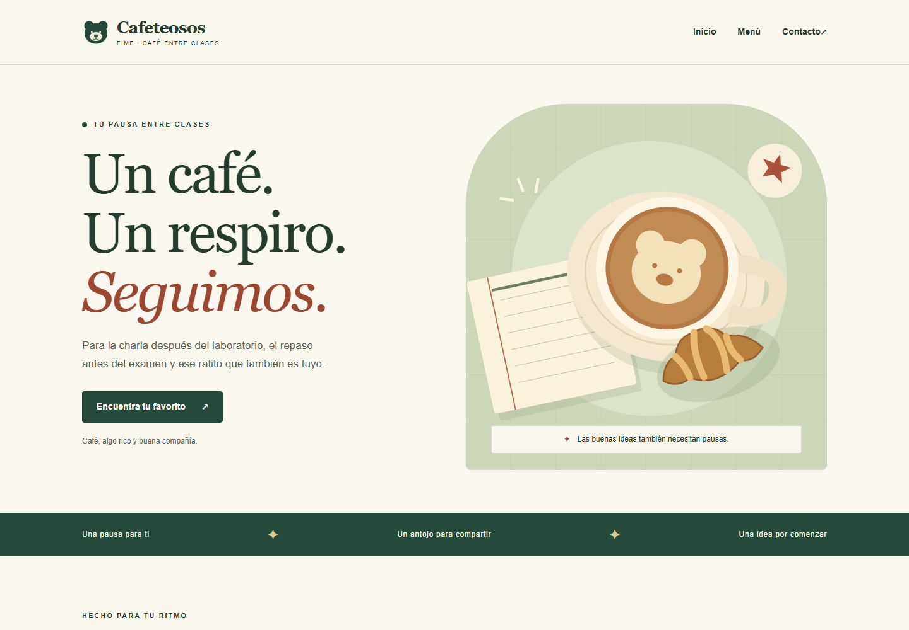
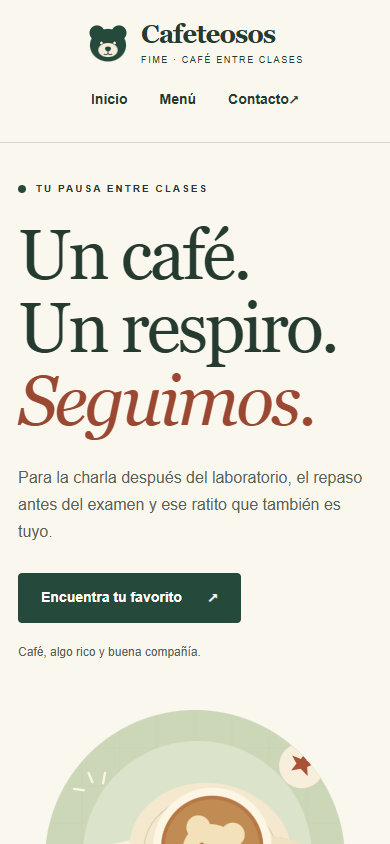
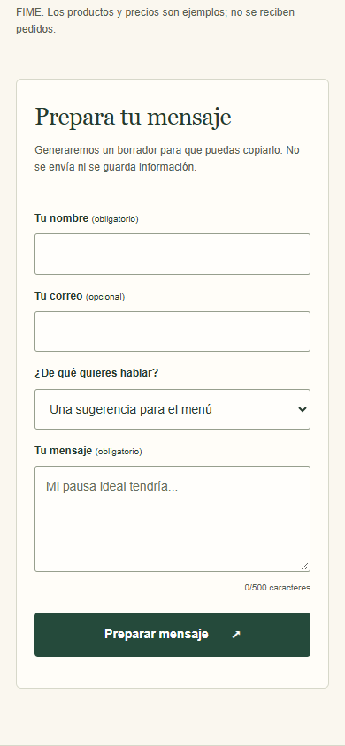
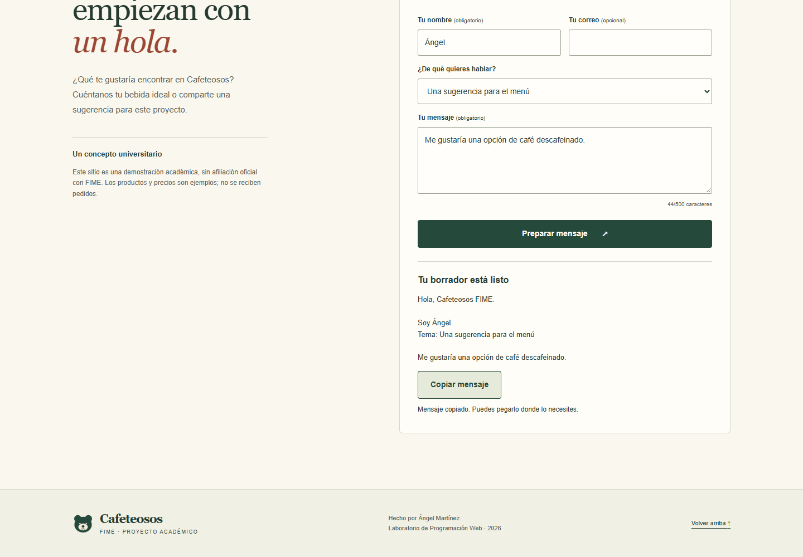

# Cafeteosos FIME

Sitio académico de una cafetería universitaria imaginaria, realizado por Ángel Martínez para la actividad de desarrollo de un sitio responsivo, semántico y accesible del Laboratorio de Programación Web.

## Objetivo

Presentar un concepto de cafetería que se pueda explorar desde computadora y teléfono. El visitante puede conocer la propuesta, filtrar seis productos y preparar un borrador de contacto. El proyecto no representa un establecimiento real ni está afiliado oficialmente con FIME; los precios son ilustrativos.

## Publicación

- Sitio: [https://code0167.github.io/cafeteosos-fime/](https://code0167.github.io/cafeteosos-fime/)
- Repositorio público: [code0167/cafeteosos-fime](https://github.com/code0167/cafeteosos-fime)
- Publicación: GitHub Pages desde la rama `main`, carpeta raíz.

Para actualizarlo, modifica los archivos y envía los cambios a `main`; GitHub Pages genera una nueva publicación.

## Tecnologías

- HTML5 con `header`, `nav`, `main`, `section`, `article`, `figure` y `footer`.
- CSS con Flexbox, Grid, variables, consultas de medios y estilos de enfoque.
- JavaScript sin librerías para filtros, contador de caracteres y borrador de contacto.
- Ilustraciones SVG originales y fuentes del sistema, sin descargas externas.
- Git para el historial y GitHub Pages como destino de publicación.

## Estructura del proyecto

```text
index.html       Estructura y contenido
styles.css       Diseño, adaptación y accesibilidad visual
script.js        Filtros y borrador de contacto
assets/          Logotipo e ilustraciones SVG originales
docs/
  capturas/        Evidencias de escritorio y móvil
  validacion-html.json
  validacion-css.xml
  pruebas-navegador.json
README.md
```

## Cómo probarlo

Abre `index.html` con un navegador. También puedes abrir la carpeta en VS Code y usar Live Server. No requiere instalar paquetes ni configurar una base de datos. La copia al portapapeles depende de que el navegador la permita; con HTTPS o un servidor local funciona, y si no está disponible se explica cómo copiar el texto manualmente.

## Secciones e interacción

**Inicio:** introduce la propuesta con un encabezado principal y un enlace al menú. La ilustración central incluye una taza con un oso, una libreta y un pan.

**Menú:** muestra seis productos mediante elementos `article`. Los botones permiten filtrar café caliente, bebidas frías o alimentos. El botón seleccionado expone `aria-pressed`, y una región de estado anuncia cuántos productos se muestran. Sin JavaScript, los seis productos siguen disponibles.

**Contacto:** cada campo está asociado a un `label`. El nombre y el mensaje son obligatorios; el correo es opcional y se valida cuando se introduce. El formulario crea un borrador local que se puede copiar. No envía correos, no realiza pedidos y no almacena datos. Sin JavaScript, el envío se desactiva y se muestra una explicación.

## Diseño responsivo

Flexbox organiza la cabecera, la navegación y los filtros. Grid distribuye el bloque principal, los productos y el contacto. Los puntos de adaptación son 1000, 700 y 360 píxeles. En móvil, el inicio y el contacto pasan a una columna; las tarjetas usan dos columnas y pasan a una en pantallas muy estrechas.

Se comprobó que no hubiera desplazamiento horizontal a 320, 390, 768 y 1440 píxeles de ancho. Las capturas corresponden a pruebas reales en Microsoft Edge.

## Accesibilidad

- Idioma español declarado y un solo `h1`, con subtítulos `h2`, `h3` y `h4` en orden.
- Texto alternativo descriptivo en las ilustraciones de contenido; imágenes repetidas o decorativas con `alt=""`.
- Enlace visible al recibir el foco para saltar al contenido principal.
- Navegación con teclado, botones nativos y enfoque visible.
- Etiquetas de formulario, validación de entradas y mensajes de estado.
- Respeto de `prefers-reduced-motion` para reducir movimientos.
- Contenido principal disponible cuando JavaScript está desactivado.

Se midieron cinco combinaciones principales de texto y fondo. Sus relaciones fueron **9.90:1, 11.20:1, 5.97:1, 5.82:1 y 6.92:1**, superiores a 4.5:1. Estas comprobaciones básicas no sustituyen una auditoría integral con tecnologías de asistencia.

## Validación y pruebas

Validación de esta versión realizada el 16 de noviembre de 2026, hora de México.

| Revisión | Resultado | Evidencia |
| --- | --- | --- |
| Nu HTML Checker del W3C | 0 errores y 0 mensajes | [Resultado HTML](docs/validacion-html.json) |
| Validador CSS del W3C, perfil CSS3 | Válido, 0 errores y 128 advertencias | [Resultado CSS](docs/validacion-css.xml) |
| Comportamiento en navegador | Pruebas completadas sin errores de JavaScript | [Resultados del navegador](docs/pruebas-navegador.json) |
| Adaptación a pantallas | Sin desbordamiento horizontal en cuatro anchos | Capturas y resultados del navegador |

Las advertencias CSS incluyen colores definidos en reglas diferentes, extensiones de proveedor, la propiedad `clip` utilizada para texto exclusivo de lectores de pantalla y limitaciones del validador con CSS moderno. No son errores de sintaxis. Los estados y contrastes se revisaron además en el navegador.

Las pruebas funcionales verificaron las etiquetas semánticas, las imágenes locales, la asociación de etiquetas con campos, el salto mediante teclado, los filtros, los campos obligatorios, el formato del correo, el borrador, la copia al portapapeles, el movimiento reducido y el contenido sin JavaScript.

Para repetir la validación, carga el HTML en [Nu HTML Checker](https://validator.w3.org/nu/) y pega el CSS en [W3C CSS Validator](https://jigsaw.w3.org/css-validator/). Los validadores pueden cambiar sus comprobaciones con el tiempo.

## Capturas

### Inicio en escritorio



### Inicio en teléfono



### Formulario adaptado a teléfono



### Borrador de contacto



Las vistas completas están en [escritorio](docs/capturas/escritorio.png) y [móvil](docs/capturas/movil.png).

## Correspondencia con la actividad

| Requisito | Implementación |
| --- | --- |
| Caso de negocio o proyecto | Concepto de cafetería universitaria Cafeteosos FIME |
| Mínimo tres secciones | Inicio, Menú y Contacto |
| HTML semántico | Encabezado, navegación, contenido principal, secciones, artículos y pie |
| Flexbox o Grid | Se utilizan ambos, sin tablas para la distribución visual |
| Al menos un breakpoint | Consultas de medios a 1000, 700 y 360 px |
| Accesibilidad básica | Alt, labels, jerarquía, teclado, contraste y mensajes de estado |
| Validación de HTML y CSS | Resultados del W3C conservados en docs |
| Publicación y repositorio | Repositorio público en code0167 y publicación mediante GitHub Pages |

## Créditos y alcance

El código, el logotipo y las ilustraciones se elaboraron para este ejercicio. No se usan logotipos oficiales de FIME ni fotografías de terceros. Los productos y la identidad visual son una propuesta académica. No se incluyen servicios de pago, pedidos, seguimiento de visitantes ni almacenamiento de datos personales.
